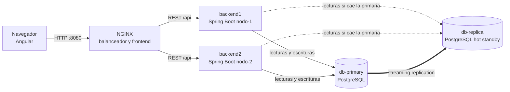
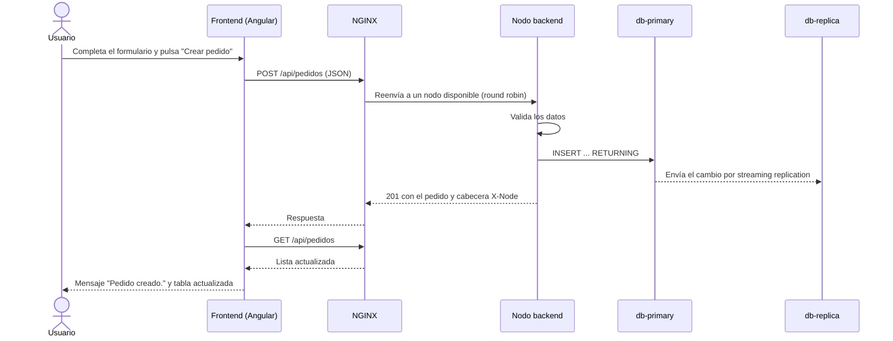
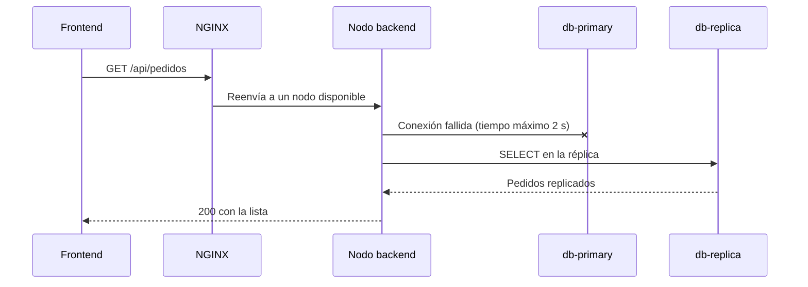
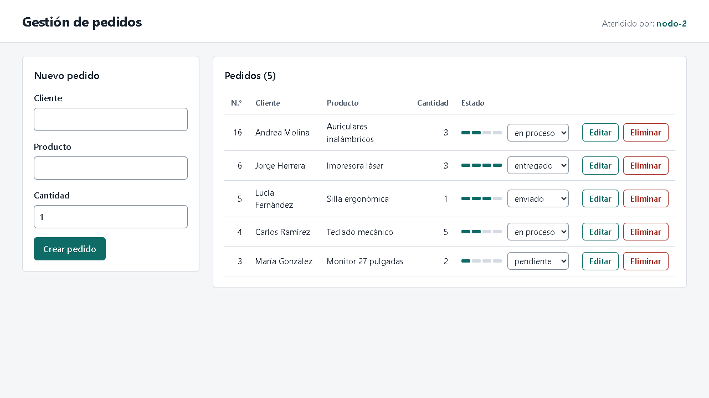
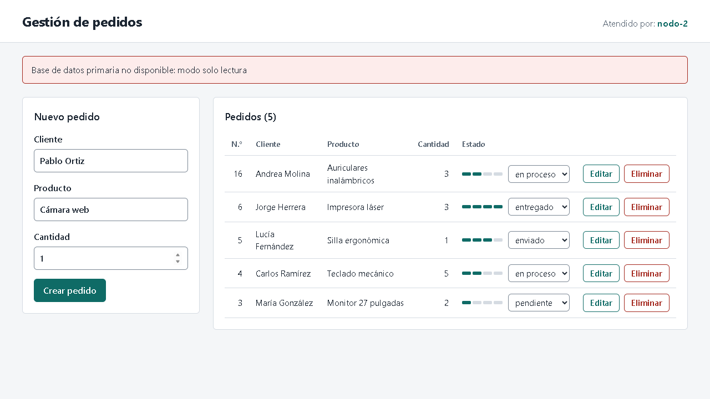

# Manual Técnico

**Sistema Distribuido de Gestión de Pedidos Tolerante a Fallos**

Proyecto Final de Sistemas Distribuidos

- Integrantes: Daniel De Jesus Codina Ortiz, Moises David Zambrano y Juan Pablo Gutierez
- Docente: Helbert Fernando Valencia Barrero

## 1. Arquitectura distribuida implementada

El sistema sigue una arquitectura cliente-servidor distribuida, desplegada con Docker Compose en cinco contenedores que se comunican por una red interna:

| Contenedor | Función | Puerto expuesto al equipo |
|---|---|---|
| `nginx` | Sirve el frontend Angular compilado y balancea la API entre los nodos | 8080 |
| `backend1` | Nodo de aplicación Java con Spring Boot (`nodo-1`) | Ninguno |
| `backend2` | Nodo de aplicación Java con Spring Boot (`nodo-2`) | Ninguno |
| `db-primary` | PostgreSQL primario: recibe todas las escrituras | Ninguno |
| `db-replica` | PostgreSQL réplica en espera (hot standby), solo lectura | Ninguno |

Los dos nodos backend ejecutan la misma imagen y no guardan estado propio: todo el estado está en la base de datos, por lo que cualquiera de los dos puede atender cualquier petición. Docker Compose comprueba cada 5 segundos que cada nodo responda en `/api/health`.

### 1.1 API REST

| Método | Ruta | Descripción | Respuestas |
|---|---|---|---|
| GET | `/api/pedidos` | Lista los pedidos, del más reciente al más antiguo | 200, 503 si ninguna base responde |
| POST | `/api/pedidos` | Crea un pedido; si no se indica estado, queda en `pendiente` | 201, 400, 503 |
| PUT | `/api/pedidos/{id}` | Actualiza cliente, producto y cantidad; el estado es opcional y, si no se envía, se conserva | 200, 400, 404, 503 |
| PUT | `/api/pedidos/{id}/estado` | Cambia solo el estado, sin modificar los demás datos | 200, 400, 404, 503 |
| DELETE | `/api/pedidos/{id}` | Elimina un pedido | 204, 400, 404, 503 |
| GET | `/api/health` | Indica el nodo y si la primaria y la réplica responden | 200 |

Cuerpo de creación o actualización:

```json
{ "cliente": "Ana Pérez", "producto": "Teclado", "cantidad": 2, "estado": "en proceso" }
```

Cuerpo del cambio de estado:

```json
{ "estado": "enviado" }
```

Los errores se devuelven en formato Problem Details (RFC 9457), con el mensaje en el campo `detail`. Cada respuesta incluye la cabecera `X-Node` con el nodo que la atendió (`nodo-1` o `nodo-2`).

### 1.2 Componentes del backend

| Clase | Responsabilidad |
|---|---|
| `Aplicacion` | Arranque de Spring Boot y filtro que agrega la cabecera `X-Node` |
| `PedidoControlador` | Rutas REST y conversión de fallos de base de datos en respuestas 503 |
| `PedidoRepositorio` | Consultas SQL, escrituras en la primaria y lecturas con respaldo en la réplica |
| `DatosPedido` | Datos recibidos y sus reglas de validación |
| `CambioEstado` | Estado recibido en un cambio de estado y su validación |
| `Pedido` | Pedido devuelto por la API |

### 1.3 Modelo de datos

Tabla `pedidos` (`base_de_datos/primaria/01_esquema.sql`):

| Campo | Tipo | Regla |
|---|---|---|
| `id` | INTEGER | Identidad generada |
| `cliente` | VARCHAR(100) | Obligatorio |
| `producto` | VARCHAR(100) | Obligatorio |
| `cantidad` | INTEGER | Entre 1 y 10000 |
| `estado` | VARCHAR(20) | `pendiente`, `en proceso`, `enviado` o `entregado`; por defecto `pendiente` |

Las mismas reglas se validan en la API con Bean Validation (`DatosPedido.java`) antes de llegar a la base de datos.

### 1.4 Seguridad aplicada

- Validación estricta de entrada: longitudes, rangos y estados permitidos. Se rechazan campos no esperados y números decimales en la cantidad.
- Consultas SQL parametrizadas en todas las operaciones.
- Los errores devueltos al cliente no incluyen trazas internas.
- Contraseñas solo en el archivo `.env`, que no se versiona.
- Usuarios de base de datos con privilegios mínimos: `app` solo puede consultar y modificar la tabla `pedidos`; `replicador` solo puede replicar.
- Solo NGINX publica un puerto; los nodos y las bases de datos quedan en la red interna.
- Los nodos backend se ejecutan con un usuario sin privilegios de administrador.
- NGINX oculta su versión, limita el tamaño de las peticiones y envía las cabeceras `Content-Security-Policy`, `X-Content-Type-Options`, `X-Frame-Options` y `Referrer-Policy`. El frontend se compila sin código JavaScript ni CSS en línea, por lo que la política de seguridad de contenido no necesita excepciones.

## 2. Diagrama de componentes y flujo de datos

### 2.1 Componentes



### 2.2 Flujo de datos: creación de un pedido



### 2.3 Flujo de datos: lectura con la primaria caída



## 3. Mecanismos de tolerancia a fallos

### 3.1 Balanceo de carga con NGINX

Archivo: `frontend/nginx.conf`.

- **Reparto:** las peticiones a `/api/` se distribuyen en round robin entre `backend1` y `backend2`.
- **Detección de nodos caídos:** si un nodo no acepta la conexión en 1 segundo (`proxy_connect_timeout 1s`), NGINX reintenta la petición en el otro nodo (`proxy_next_upstream error timeout`) y marca el nodo como no disponible durante 10 segundos (`max_fails=1 fail_timeout=10s`).
- **Sin pedidos duplicados:** NGINX no reenvía al otro nodo una petición POST que ya llegó a un nodo, porque no es idempotente. Solo reintenta cuando la conexión no llegó a establecerse.
- **Recuperación automática:** NGINX vuelve a resolver los nombres de los nodos cada 5 segundos con el DNS interno de Docker (`resolver 127.0.0.11` y el parámetro `resolve`). Así, un nodo que vuelve, aunque reciba otra dirección IP, se reincorpora sin reiniciar NGINX.

### 3.2 Replicación de la base de datos

Archivos: `base_de_datos/primaria/` y `base_de_datos/replica/iniciar_replica.sh`.

- Al iniciar por primera vez, la réplica copia la base primaria con `pg_basebackup` y queda configurada como réplica en espera (`-R`).
- Después recibe en tiempo real cada cambio de la primaria por **streaming replication**, de modo que conserva una copia íntegra y actualizada de los pedidos.
- La réplica acepta consultas de lectura (hot standby) y rechaza las escrituras.
- Si la primaria se detiene, la réplica sigue en marcha y se reconecta sola cuando la primaria vuelve.

### 3.3 Conmutación de lecturas en los nodos backend

Archivo: `backend/src/main/java/pedidos/PedidoRepositorio.java`.

- **Escrituras** (crear, actualizar, eliminar): siempre en la primaria. Si no responde, la API devuelve `503` con el mensaje `Base de datos primaria no disponible: modo solo lectura`, que el frontend muestra al usuario.
- **Lecturas** (listar): se intentan en la primaria y, si no responde, se atienden desde la réplica.
- Cada consulta abre su propia conexión con un tiempo máximo de 2 segundos (`connectTimeout=2`). Cuando la primaria vuelve, la siguiente consulta ya la usa, sin reiniciar los nodos.
- En la interfaz, un cambio de estado que el servidor rechaza no queda mostrado: la lista sigue indicando el estado guardado.
- El cambio de estado desde la lista envía solo el nuevo estado. Así no sobrescribe el cliente, el producto o la cantidad que otro usuario haya editado mientras tanto.

### 3.4 Limitación conocida

La réplica no se promueve automáticamente a primaria. Mientras la primaria esté detenida, el sistema permite consultar pedidos pero no modificarlos; las escrituras se restablecen cuando la primaria vuelve.

## 4. Ejemplo de fallo simulado y comportamiento del sistema

Los dos casos se reproducen de forma automática con `backend/src/test/java/pedidos/FallosIT.java` y manualmente con los comandos indicados. Los resultados son los observados en la ejecución del 8 de noviembre de 2026 (detalle en el [Informe de Pruebas](informe_pruebas.md)).

### 4.1 Caída de un nodo backend

Comando: `docker compose stop backend1`

| Acción | Comportamiento observado |
|---|---|
| 4 consultas `GET /api/pedidos` | Todas respondieron 200, atendidas por `nodo-2` |
| Creación de un pedido | 201, atendida por `nodo-2`, sin errores para el usuario |
| `docker compose start backend1` | `nodo-1` volvió a recibir peticiones sin reiniciar NGINX |

La interfaz siguió funcionando e indicó el nodo que atendía:



### 4.2 Caída de la base de datos primaria

Comando: `docker compose stop db-primary`

| Acción | Comportamiento observado |
|---|---|
| `GET /api/pedidos` | 200, con los pedidos leídos desde la réplica |
| Creación de un pedido | 503: `Base de datos primaria no disponible: modo solo lectura` |
| Cambio de estado desde la interfaz | Rechazado con el mismo aviso; la lista siguió mostrando el estado guardado |
| `GET /api/health` | `primaria: false`, `replica: true` |
| `docker compose start db-primary` | Las escrituras volvieron a funcionar y la eliminación posterior se replicó en la réplica |

La interfaz mantuvo la lista visible y mostró el aviso al intentar crear un pedido:



## 5. Tecnologías empleadas y justificación

| Tecnología | Versión | Uso | Justificación |
|---|---|---|---|
| Angular | 22.2.5 | Interfaz de usuario | Requerido por el proyecto; componentes, señales y formularios reactivos sin librerías adicionales |
| TypeScript, HTML5, CSS3 | 6.0.3 | Lógica, estructura y estilos del cliente | Lenguajes de Angular; tipado estricto en código y plantillas |
| Java | 25 | Lenguaje del backend | Requerido por el proyecto; versión de soporte extendido (LTS) |
| Spring Boot | 4.1.2 | API REST de cada nodo | Estándar para servicios REST en Java; incluye servidor web, validación y manejo de errores |
| Bean Validation (Hibernate Validator) | 9.1.5 | Validación de datos | Rechaza datos inválidos antes de llegar a la base de datos |
| Spring JDBC y controlador PostgreSQL | 7.0.10 y 42.7.14 | Conexión a PostgreSQL | Consultas parametrizadas y control del tiempo de conexión |
| Maven y Maven Wrapper | 3.9.16 | Compilación y pruebas del backend | El wrapper descarga Maven, por lo que solo se necesita el JDK |
| PostgreSQL | 16.15 | Base de datos | Opción permitida por el proyecto; replicación por streaming incluida sin extensiones |
| NGINX | 1.30.6 | Balanceador de carga y servidor web | Mecanismo sugerido por el proyecto; detecta nodos caídos y reintenta en otro nodo |
| Docker Compose | v2 | Despliegue | Sugerido por el proyecto para simular los nodos distribuidos en un solo equipo |
| JUnit y ESLint | 6.0.3 y 10.14.0 | Pruebas y análisis estático | Verifican el funcionamiento y la calidad del código |
