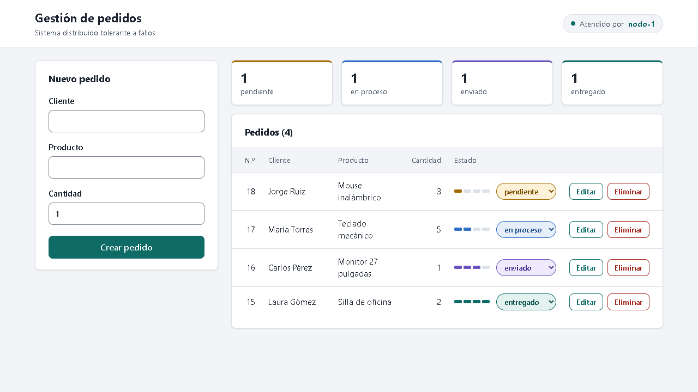
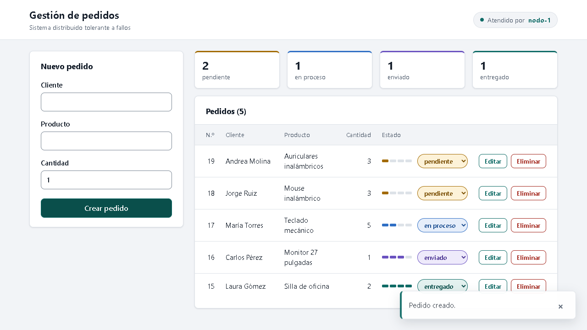
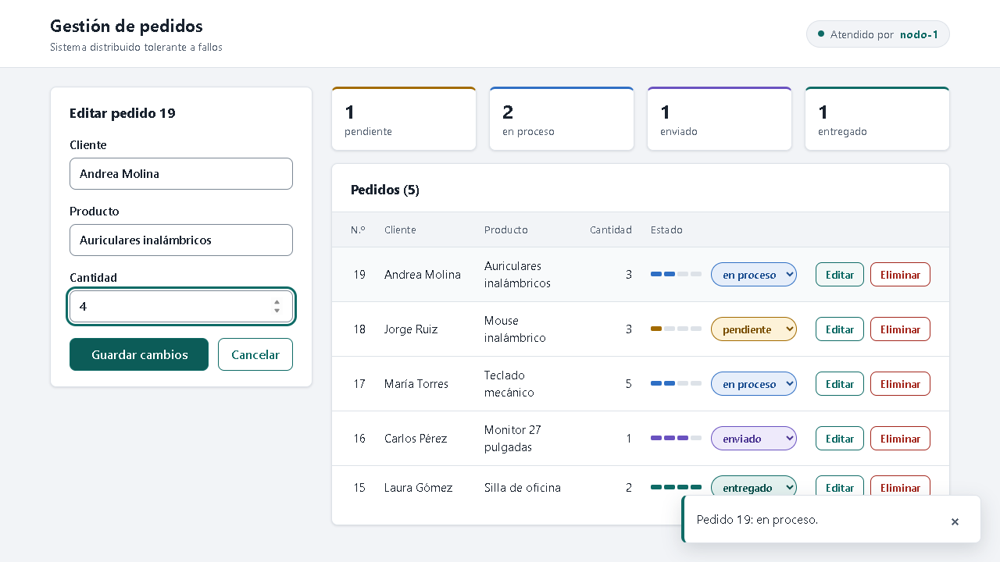
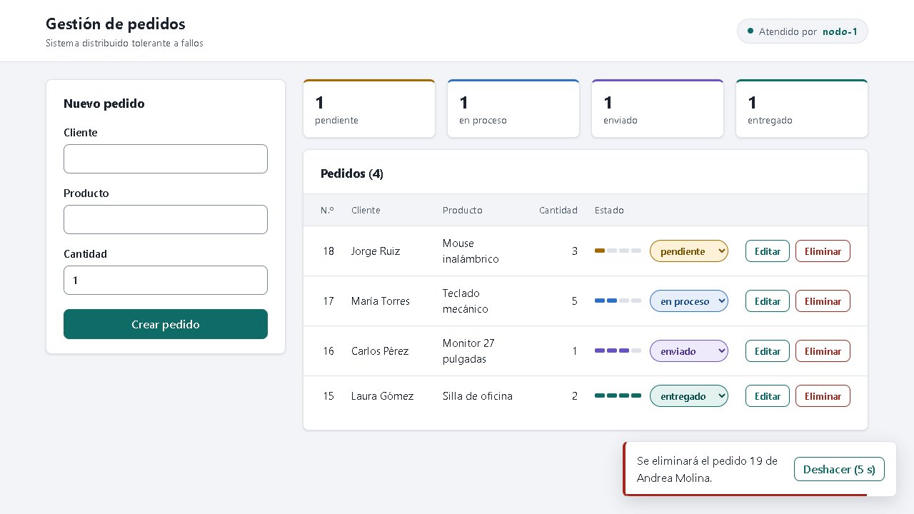
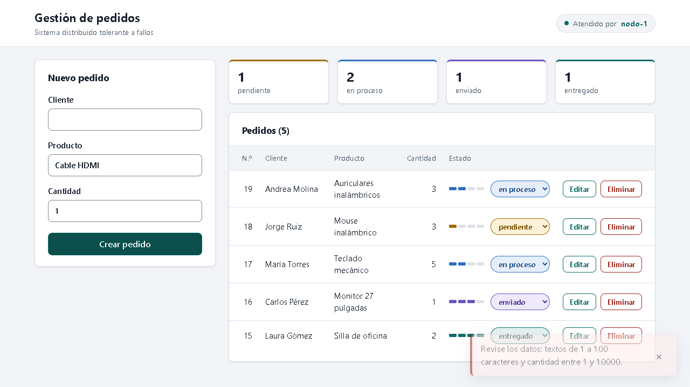
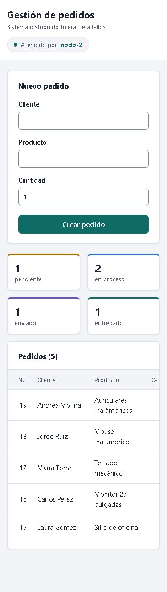
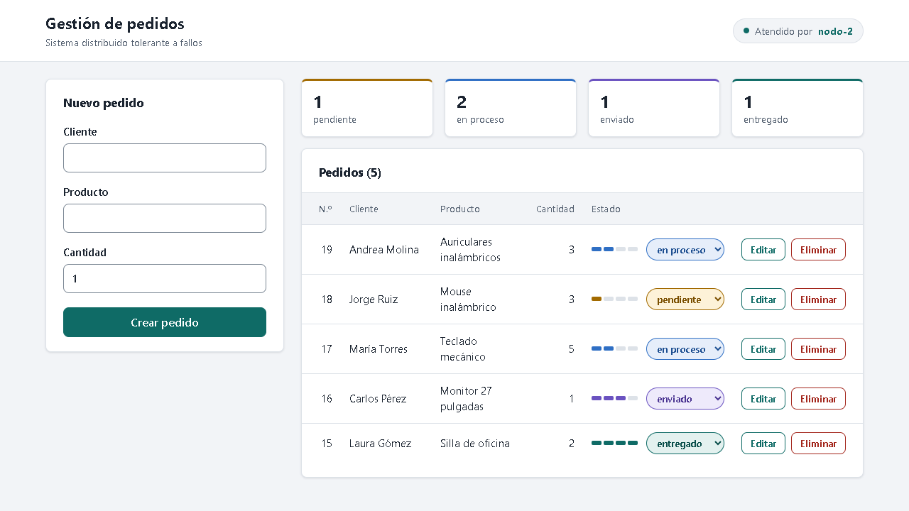
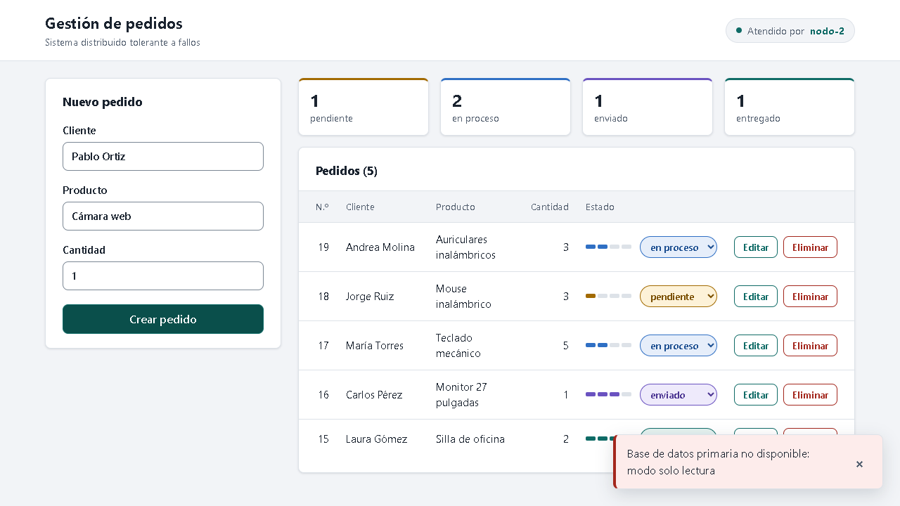

# Manual de Usuario

**Sistema Distribuido de Gestión de Pedidos Tolerante a Fallos**

Proyecto Final de Sistemas Distribuidos

- Integrantes: Daniel De Jesus Codina Ortiz, Moises David Zambrano y Juan Pablo Gutierez
- Docente: Helbert Fernando Valencia Barrero

## 1. Instalación y ejecución

### 1.1 Requisitos

- Docker Desktop instalado y en ejecución (incluye Docker Compose).
- Navegador web actualizado.

### 1.2 Pasos

1. Descomprimir el proyecto y abrir una terminal en la carpeta principal.
2. Crear el archivo de configuración a partir del ejemplo:
   - Windows (PowerShell): `Copy-Item .env.example .env`
   - Linux o macOS: `cp .env.example .env`
3. Abrir `.env` y reemplazar las tres contraseñas de ejemplo (sin espacios ni comillas).
4. Construir y levantar el sistema:

   ```bash
   docker compose up -d --build
   ```

   La primera vez tarda unos minutos porque descarga las imágenes y compila la aplicación.
5. Abrir <http://localhost:8080> en el navegador.

Para detener el sistema: `docker compose down`. Los pedidos se conservan para el próximo inicio. Para borrarlos: `docker compose down -v`.

## 2. Funciones disponibles

La pantalla tiene tres zonas: la cabecera con el nodo que atendió la última consulta, el formulario a la izquierda y, a la derecha, el total de pedidos por estado y la lista de pedidos. En pantallas pequeñas el formulario aparece arriba y la lista debajo.

Los mensajes del sistema aparecen como avisos abajo a la derecha. Los de éxito se ocultan solos a los 4 segundos; los de error quedan visibles hasta cerrarlos con **×**.



### 2.1 Crear un pedido

1. Escribir el **cliente** y el **producto** (hasta 100 caracteres cada uno).
2. Indicar la **cantidad** (de 1 a 10000).
3. Pulsar **Crear pedido**.

El pedido aparece al inicio de la lista con el estado `pendiente` y se muestra el mensaje «Pedido creado.».



### 2.2 Listar pedidos

La lista muestra todos los pedidos, del más reciente al más antiguo, con su número, cliente, producto, cantidad y estado. El título indica el total de pedidos.

### 2.3 Cambiar el estado

Cada pedido tiene una barra de cuatro tramos y una lista desplegable con los estados `pendiente`, `en proceso`, `enviado` y `entregado`. Al elegir un estado nuevo, el cambio se guarda de inmediato y la barra se actualiza. Solo cambia el estado; los demás datos del pedido se mantienen.


### 2.4 Editar un pedido

1. Pulsar **Editar** en la fila del pedido.
2. El formulario cambia a «Editar pedido N» con los datos actuales.
3. Modificar los datos y pulsar **Guardar cambios**, o **Cancelar** para volver sin guardar.



### 2.5 Eliminar un pedido

Pulsar **Eliminar** en la fila del pedido. El pedido desaparece de la lista y abajo a la derecha aparece un aviso con una cuenta regresiva de 5 segundos:

- Para conservarlo, pulsar **Deshacer** antes de que termine la cuenta.
- Al terminar la cuenta, el pedido se elimina definitivamente y aparece el aviso «Pedido N eliminado.».

Si se cierra la página antes de que termine la cuenta, el pedido no se elimina.



### 2.6 Mensajes del sistema

| Mensaje | Significado | Qué hacer |
|---|---|---|
| Revise los datos: textos de 1 a 100 caracteres y cantidad entre 1 y 10000. | Algún dato no es válido | Corregir el formulario |
| Base de datos primaria no disponible: modo solo lectura | La base primaria no responde; se pueden consultar pedidos pero no modificarlos | Esperar a que el administrador restablezca la base primaria |
| Base de datos no disponible | Ni la base primaria ni la réplica responden | Esperar a que el administrador restablezca las bases de datos |
| Pedido no encontrado | El pedido fue eliminado por otro usuario | Recargar la página para ver la lista actualizada |
| No hay nodos disponibles para atender la solicitud. | Ningún nodo backend responde | Intentar de nuevo en unos segundos |
| No se pudo conectar con el servidor. | El sistema no está en ejecución | Verificar que Docker y el sistema estén levantados |



## 3. Capturas del sistema funcionando

**Uso desde un teléfono (375 px de ancho).** La lista se desplaza horizontalmente para ver el estado y las acciones.



**Funcionamiento con un nodo caído.** Con `backend1` detenido, todas las peticiones las atiende `nodo-2` y el usuario no percibe errores.



**Modo solo lectura.** Con la base primaria detenida, la lista sigue disponible y el sistema avisa que no se pueden registrar cambios.


